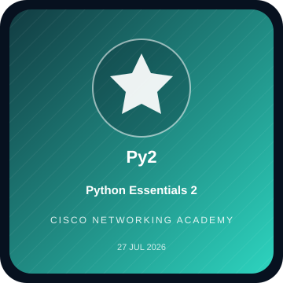

# Credentials & Digital Badges

> A curated record of learning credentials and digital badges. Credential names and issue dates below reflect the information supplied for this profile. Where an individual public badge URL is available, it is linked directly; otherwise, use the public Credly profile to open the issuer record. The square images are **profile-designed visual tiles**, not scans or substitutes for issuer-issued badge artwork.

## Public verification

- [Credly public profile](https://www.credly.com/users/arfat-alkamly)
- [GitHub profile](https://github.com/arfat-alkamly)

## Cisco Networking Academy — Digital Badges

<table>
<tr>
<td align="center" width="33%"> <b>Cybersecurity Defense Analyst Career Path</b> 29 Jul 2026</td>
<td align="center" width="33%"> <b>Network Defense</b> 27 Jul 2026</td>
<td align="center" width="33%"> <b>Networking Basics</b> 27 Jul 2026</td>
</tr>
<tr>
<td align="center"> <b>Python Essentials 2</b> 27 Jul 2026</td>
<td align="center"> <b>Python Essentials 1</b> 25 Jul 2026</td>
<td align="center"> <b>Introduction to Modern AI</b> 23 Jul 2026</td>
</tr>
<tr>
<td align="center"> <b>Endpoint Security</b> 03 Jun 2026 · <a href="https://www.credly.com/badges/f0520c01-63aa-4440-9df4-69c7303d8762/public_url">Verify badge</a></td>
<td align="center"> <b>Create Digital Content, Communicate and Collaborate Online</b> 27 May 2026</td>
<td align="center"> <b>Introduction to Cybersecurity</b> 18 May 2026</td>
</tr>
</table>

## Additional achievements

| Achievement | Public record |
|---|---|
| Cisco IT Customer Support Basics | [Credly badge](https://www.credly.com/badges/dd68b74c-65f9-468f-9a51-3bb78adad239/public_url) |
| Cisco Learn-A-Thon 2026 — Participant | [Credly badge](https://www.credly.com/badges/a370a36f-7ce1-4531-b44b-b909e56ee52d/public_url) |
| Introduction to Artificial Intelligence | [Learning credential](https://lnkd.in/dRCcTwf5) |

## Credential presentation policy

- A course-completion badge is described as a **digital learning credential**, not as a professional license or degree.
- No certification number, expiration date, score, or professional status is inferred when it is not present in the public record.
- New certificates can be added when their issuer, title, issue date, and public verification link or certificate image are available.
- Official badge verification remains on the issuer/Credly page; the square tiles above are custom visual index cards for this repository.
