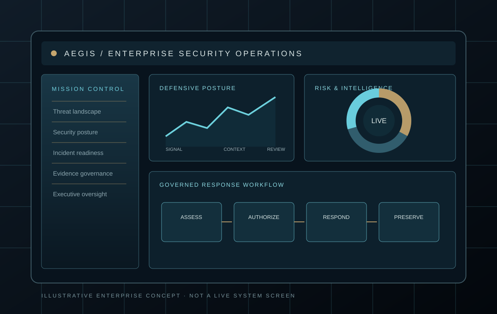
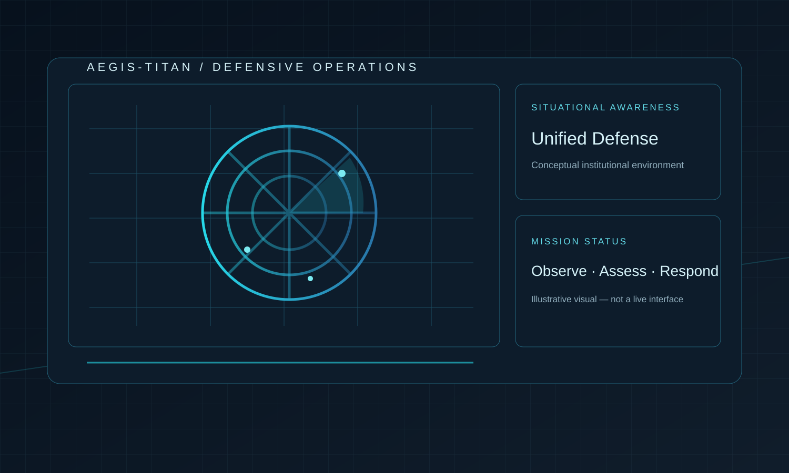
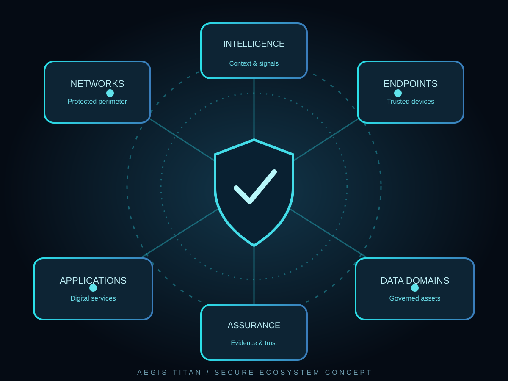
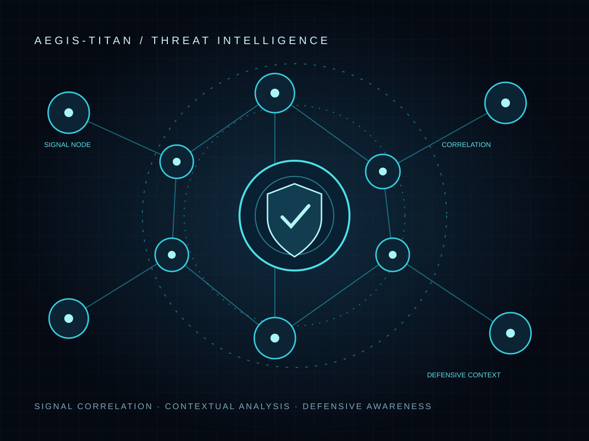
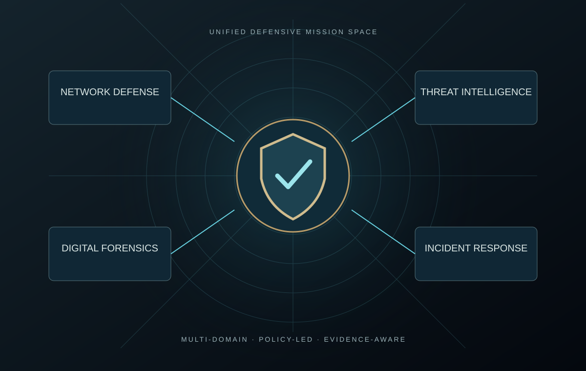
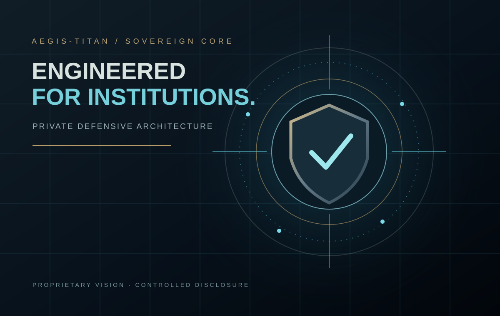
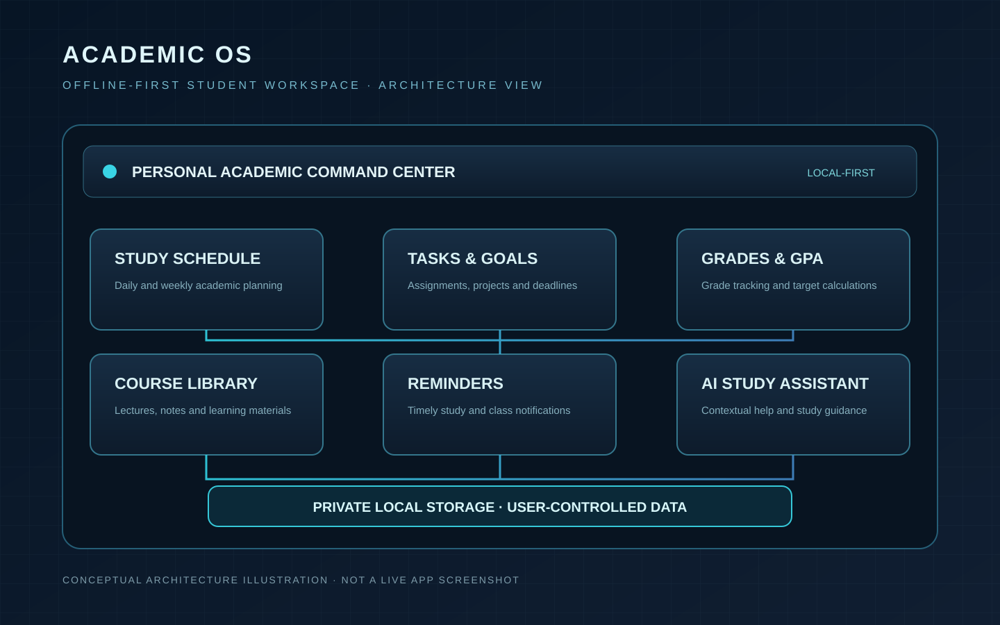

# Engineering Projects Portfolio
### Cybersecurity Engineering · Software Development · Applied Technical Work

**Independent development · Academic engineering · Defensive security**

---

## Portfolio at a glance

This document separates **independently developed projects**, **practical learning environments**, and **future project concepts**. Visuals labelled *concept illustration* explain architecture or design direction; they are not presented as screenshots of a running product.

| Project | Domain | Reported status |
|---|---|---|
| **AEGIS-TITAN v9.0-SOVEREIGN** | Defensive Cybersecurity / SOC / DFIR | Independent development; developer-reported practical testing |
| **Academic OS** | Software Engineering / Academic Productivity | Personal application project; feature maturity varies |
| Student Management System | Java / Object-Oriented Programming | Completed academic project |
| Tourism Platform | Front-End Web Development | Completed academic project |
| Cybersecurity Portfolio | Research / Technical Documentation | Ongoing documentation |
| Virtual Pentesting Lab | Virtualization / Network Security | Learning environment in progress |
| Network Security Projects | Network Defense / Monitoring | Practical exercises and lab work |
| AI-Powered Threat Detection | AI Security | Planned concept |
| Cloud-Native SIEM Dashboard | Cloud Security / SIEM | Planned concept |
| Mobile App Security Assessment Framework | Mobile Security | Planned concept |

---

# 01 · AEGIS-TITAN v9.0-SOVEREIGN

**Defensive Cybersecurity System**  
Independent development · Python · Kali Linux · SOC-oriented workflows

<b>Figure 1.</b> SOC operations interface concept. This is an illustrative design, not a screenshot of the running system.

### Project overview

AEGIS-TITAN is an independently developed defensive cybersecurity project intended to bring multiple security workflows into one operational environment. Its design direction focuses on monitoring, detection, investigation, evidence-aware analysis, and controlled response.

The project follows a defensive operating philosophy. It is not designed for retaliation, hack-back, or unauthorized access to external systems.

### Visual system map

<table>
<tr>
<td width="50%" align="center"> <b>Defensive command environment</b> Conceptual operations environment</td>
<td width="50%" align="center"> <b>Protected network ecosystem</b> Network architecture illustration</td>
</tr>
<tr>
<td width="50%" align="center"> <b>Threat intelligence field</b> Signals, correlation and context</td>
<td width="50%" align="center"> <b>Unified defensive mission space</b> Defensive domains overview</td>
</tr>
</table>

 <b>Figure 6.</b> AEGIS core visual identity and system concept.

### Capability domains

| Domain | Intended engineering role |
|---|---|
| Security monitoring & telemetry | Collect and organize system and network observations |
| Threat detection & analysis | Identify suspicious activity and support contextual investigation |
| Incident handling | Support controlled isolation and response workflows |
| Deception & honeypots | Apply defensive deception to observe suspicious interactions |
| Digital forensics support | Organize event context and evidence-oriented records |
| Threat-path analysis | Connect observations into a more useful investigation view |
| Source-code security review | Support review of codebases and open-source dependencies |

### Engineering profile

| Area | Details |
|---|---|
| Primary language | Python |
| Development environment | Kali Linux |
| Interface direction | SOC-oriented desktop interface |
| Engineering focus | Modular defensive workflows, telemetry, analysis, and incident handling |

### Development status & evidence

The developer reports that core modules have been implemented and exercised in practical tests. This remains an independently developed project. The visuals in this document are design and architecture illustrations—not live captures of the application. This repository does not claim an independent security audit, formal certification, or production deployment.

**Evidence to publish next:** sanitized live interface captures, a reproducible test log, sample detection events, architecture notes, and a redacted investigation report. Screenshots should be added only from the actual running application.

### Safety and authorization

AEGIS-TITAN is intended for systems and networks owned by the operator or covered by explicit authorization. Its response model is defensive and controlled; unauthorized access, destructive actions, and retaliation against external systems are outside the project scope.

---

# 02 · Academic OS

**Offline-First Academic Assistant**  
Personal software project · Dart / Flutter direction · Local-first academic workflows

<b>Figure 1.</b> Conceptual product architecture based on the documented feature set. It is not a screenshot of the running application.

### Vision

Academic OS is a local-first academic assistant designed to help students organize study schedules, tasks, goals, course materials, reminders, and grade tracking in one private workspace. The project emphasizes offline availability, user control over academic data, and a focused bilingual experience.

### Main functional areas

- **Academic organization:** subjects, course information, study schedules, tasks, and deadlines.
- **Grade tracking:** course marks, GPA calculations, and progress toward academic targets.
- **Learning materials:** local lecture-file organization, search, and study-note workflows.
- **Study assistance:** an integrated assistant concept for helping organize and understand study content.
- **Reminders:** notifications for classes, assignments, exams, and planned study sessions.
- **Personalization:** Arabic/English interface direction, dark mode, and user-configurable application access controls.
- **Backup:** optional user-controlled backup workflow.

### Privacy and architecture principles

| Principle | Design direction |
|---|---|
| Offline-first | Core academic workflows should remain useful without a network connection |
| Local data control | Keep personal academic records under the user's control |
| Privacy-aware access | Provide application-lock options and protect sensitive academic content |
| Modular design | Keep schedules, grades, files, reminders, and assistant workflows separable |
| Transparent backup | Make backup an explicit user-controlled action |

### Status and implementation note

This is a personal application project. The feature list above describes the project's documented scope; it should not be interpreted as proof that every advanced feature is already implemented or independently tested. Specific implementation details such as database encryption, biometric authentication, on-device AI, OCR, and automated analytics should be documented with technical evidence before being described as completed capabilities.

**Evidence to publish next:** genuine screenshots from the running application, a short feature walkthrough, a redacted local-data example, and a technical architecture note.

---

# 03 · Student Management System

**Java · Object-Oriented Programming · Academic Project**

**Status:** Completed academic project

A command-line student-record application developed as an object-oriented programming project. It organizes student and course records and supports grade-related operations.

### Documented functions

- Add, remove, and update student records.
- Manage course and grade information.
- Calculate GPA.
- Save and retrieve information using file input/output.

### Technical concepts

Java · Encapsulation · Inheritance · Polymorphism · Abstraction · File I/O

**Suggested evidence:** a real terminal screenshot, sample input/output session, and a small class diagram.

---

# 04 · Tourism Platform

**HTML5 · CSS3 · JavaScript · Web Development**

**Status:** Completed academic project

A web platform for presenting tourism destinations and related information, with a responsive browsing experience. The project was documented as published through GitHub Pages.

### Documented functions

- Present destination information.
- Provide straightforward navigation and browsing.
- Adapt page layout to different screen sizes.

**Suggested evidence:** actual browser screenshots, the public deployment URL, and a link to the source repository. Add the live URL here once it has been confirmed.

---

# 05 · Cybersecurity Portfolio

**Security Research · Labs · Tools · Technical Documentation**

**Status:** In progress

A structured body of cybersecurity learning and research documentation intended to collect practical exercises, technical notes, security analysis, and independently developed helper tools.

### Workstreams

- Security research notes and vulnerability analysis.
- Virtual lab write-ups and reproducible exercises.
- Python-based helper tools.
- Technical references and structured documentation.

Research notes and proposals should be distinguished from validated findings, public disclosures, or peer-reviewed publications.

---

# 06 · Virtual Pentesting Lab

**VMware · Kali Linux · Windows · Ubuntu · pfSense**

**Status:** In progress

An isolated virtual environment for learning authorized penetration testing and network security. The environment is intended to simulate multiple roles in a small enterprise network.

### Planned / documented environment

| Virtual machine | Intended role |
|---|---|
| Kali Linux | Authorized assessment workstation |
| Windows Server | Directory services and Windows server target |
| Windows 10 | Client workstation |
| Ubuntu Server | Linux server and web-service target |
| pfSense | Firewall and network segmentation |

### Learning scenarios

- Web security testing mapped to OWASP Top 10.
- Active Directory security concepts in an isolated lab.
- Privilege and access-control review.
- Network traffic capture and analysis.

All offensive testing is restricted to the isolated lab or systems for which explicit authorization has been granted.

---

# 07 · Network Security Projects

**Network Defense · Monitoring · Cisco · Wireshark · pfSense**

**Status:** Practical learning

A collection of networking and defensive-security exercises covering secure network configuration, visibility, traffic analysis, and firewall policy.

### Workstreams

**Cisco network configuration**
- VLANs and trunking.
- Access Control Lists (ACLs).
- VPN concepts and IPsec configuration exercises.

**Network traffic analysis**
- Capture and inspect traffic with Wireshark.
- Identify unusual patterns and suspicious communications.
- Explore network detection rules and Snort concepts.

**Firewall configuration**
- pfSense firewall policy.
- NAT and controlled port forwarding.
- Segmentation and least-privilege network rules.

---

# 08 · AI-Powered Threat Detection System

**Status:** Planned concept

A proposed machine-learning project exploring anomaly detection and security-event classification from network or host telemetry.

### Proposed stack

Python · Scikit-learn / TensorFlow · Pandas · NumPy · Wireshark / TShark

### Research questions

- Which features are useful for identifying anomalous network behavior?
- How can detection quality be measured against false-positive rates?
- How should model output be explained to a security analyst?
- How can experiments be reproduced with documented datasets?

This is a planned concept, not a completed detection product.

---

# 09 · Cloud-Native SIEM Dashboard

**Status:** Planned concept

A proposed security monitoring dashboard for collecting, searching, and visualizing security events from multiple sources.

### Proposed technologies

Elastic Stack · Docker · AWS / Azure · Python

### Proposed outcomes

- Centralized event collection.
- Searchable security records.
- Analyst-oriented dashboards.
- Documented alert rules and test events.

This project remains a future learning and engineering target.

---

# 10 · Mobile App Security Assessment Framework

**Status:** Planned concept

A proposed framework for organizing authorized static and dynamic security assessments of Android and iOS applications.

### Proposed technologies

Python · MobSF · Frida · Flutter (for a possible interface)

### Proposed assessment areas

- Insecure local data storage.
- Network communication and TLS configuration.
- Permission and component exposure.
- Static findings and dynamic behavior.
- Reproducible reporting and remediation guidance.

This is a planned framework, not a released assessment tool.

---

## Engineering Evidence Standard

To keep this portfolio credible, each project should grow through a consistent evidence set:

1. **Real product evidence:** screenshots or a short recording from the actual running application.
2. **Architecture:** a diagram that matches the implemented design.
3. **Reproducibility:** setup steps, environment, dependencies, and test instructions.
4. **Validation:** test cases, observed outputs, limitations, and known issues.
5. **Security and privacy:** authorization boundaries, data handling, and disclosure notes.
6. **Release record:** version, change log, and source repository or demo link.

> **Portfolio principle:** clearly distinguish what is implemented, what has been tested, what is a design proposal, and what remains planned.

---

**BUILDING SYSTEMS. SECURING THE FUTURE.**

Arfat Alkamali · Cybersecurity & Networks · Independent Engineering

