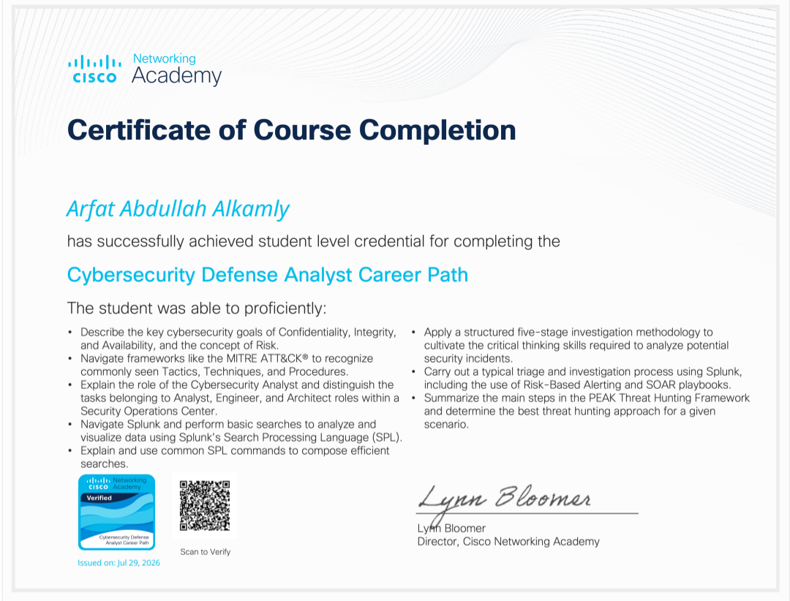
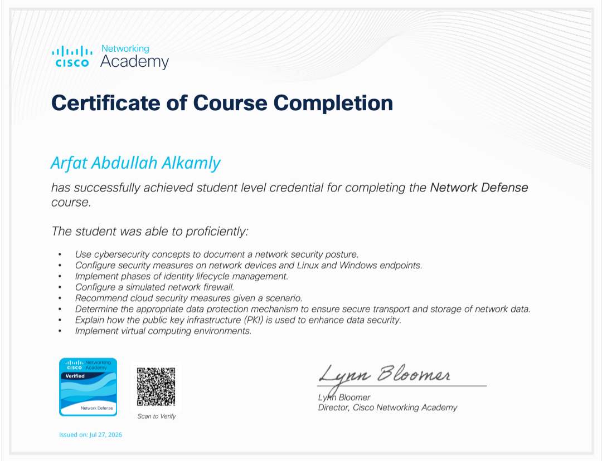
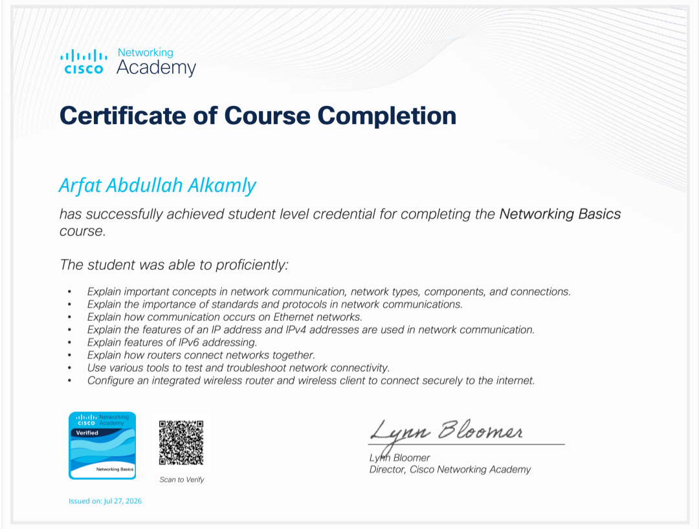
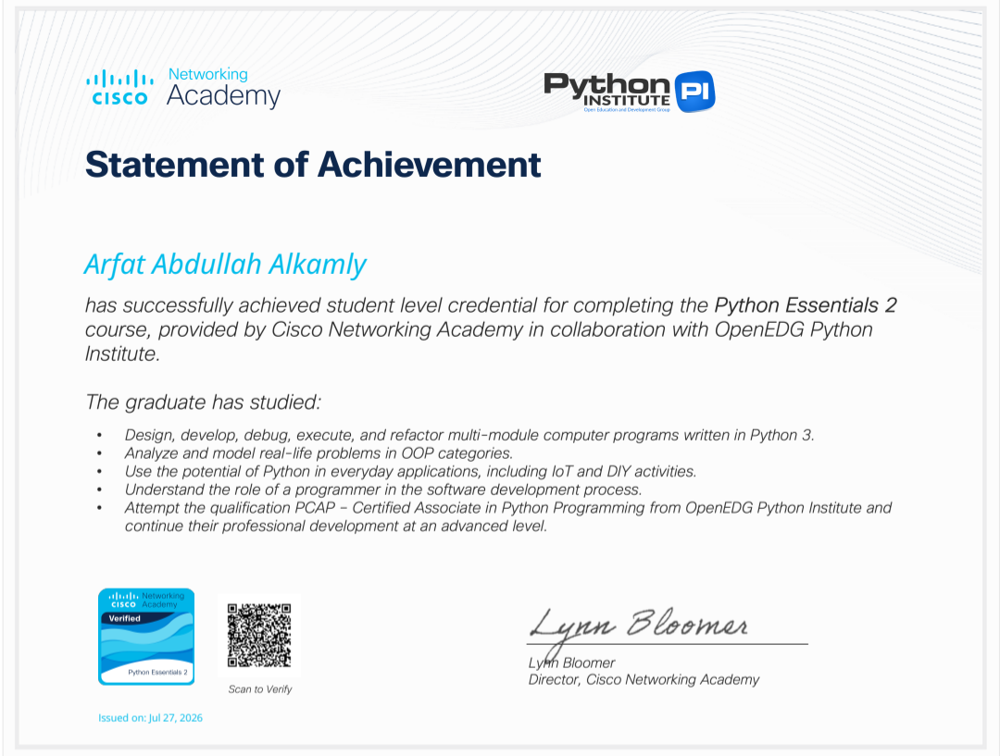
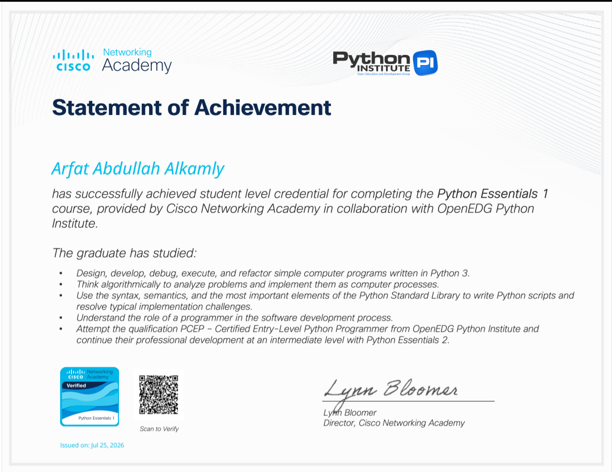
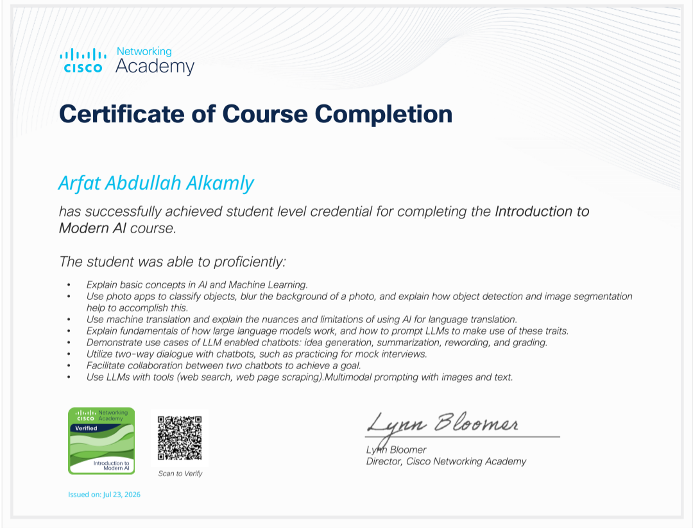
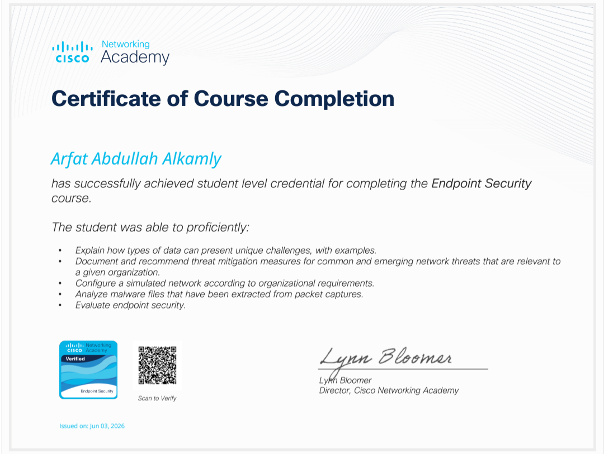
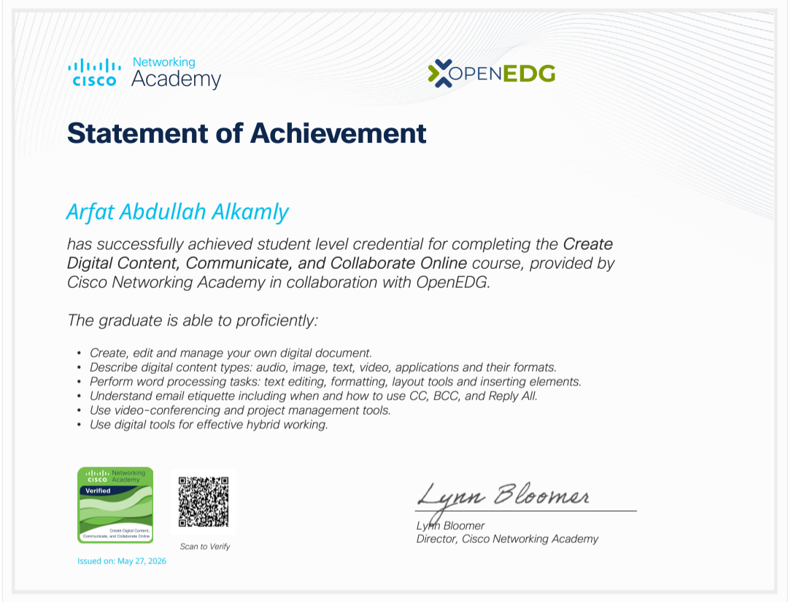
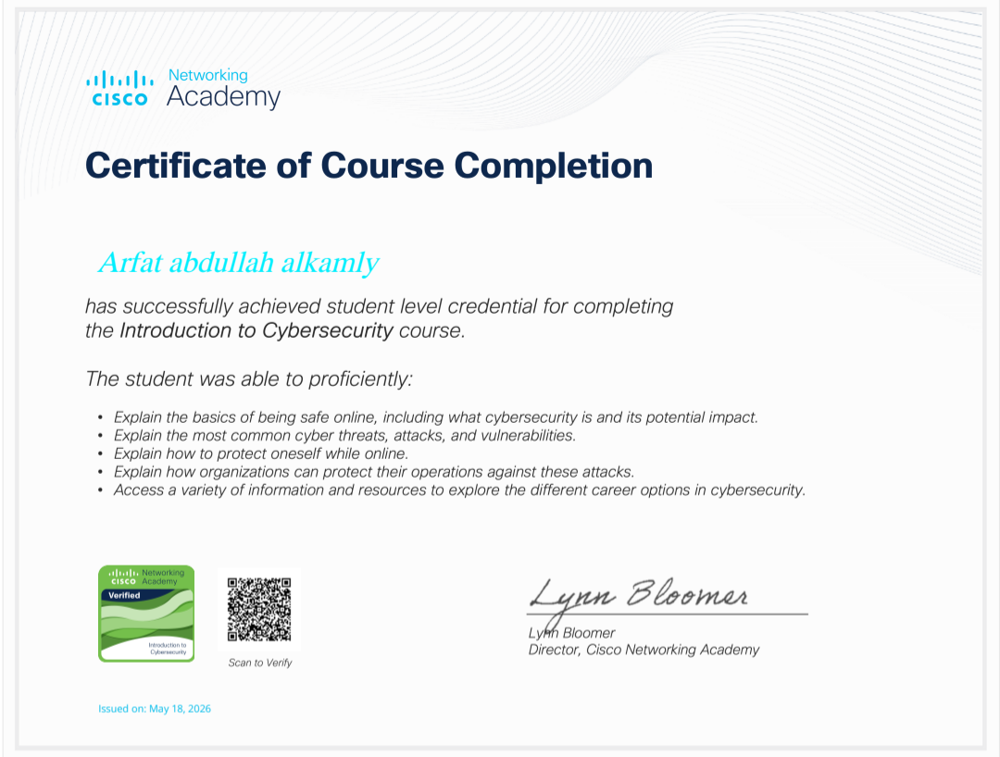

# Arfat Alkamly
### Cybersecurity & Networks · Software Engineering · Security Research

---

## Professional Profile

I am an undergraduate **Cybersecurity & Networks** student at **Al-Manar University College for Science & Technology**, Yemen. My technical path combines defensive cybersecurity, network protection, secure software engineering, and applied research.

I develop independent software and security projects alongside my academic studies. I am particularly interested in analyzing vulnerabilities at code and infrastructure level, designing dependable systems, and turning security concepts into practical tools, repeatable tests, and clear technical documentation.

**Professional direction:** Cybersecurity Engineering · Security Operations & Threat Detection · Secure Software Engineering · Applied Research

> **Building Systems. Securing the Future.**

## Engineering Focus

| Domain | Areas of interest |
|---|---|
| Cybersecurity Engineering | Defensive architecture, vulnerability analysis, security controls, risk-aware design |
| Network Security | Traffic analysis, network visibility, segmentation, monitoring, Cisco technologies |
| Security Operations | SOC workflows, threat detection, alert analysis, incident handling |
| Secure Software | Application development, source-code review, secure design, database security |
| Digital Forensics | Evidence-aware investigation, incident documentation, forensic workflows |
| Applied Research | Threat analysis, software supply-chain risk, AI-assisted defense |

## Selected Projects

### AEGIS-TITAN v9.0-SOVEREIGN — Defensive Cybersecurity System

An independently developed defensive security project intended to connect monitoring, threat analysis, detection, containment, deception, and incident-response workflows. Its design is defensive and excludes retaliatory attacks or hack-back activity.

**Capability areas:** Security telemetry · Threat detection · Network monitoring · Controlled response · Honeypots and deception · DFIR support · Threat-path analysis · Source-code security review

**Engineering profile:** Python · Kali Linux · Modular security workflows · SOC-oriented interface

*Implementation and testing status are developer-reported; this profile does not claim a third-party audit or production certification.*

### Academic OS — Offline Academic Assistant

A local-first academic productivity application for organizing study schedules, tasks, goals, course files, reminders, and grade tracking, with an emphasis on privacy and offline use.

**Engineering focus:** Flutter/Dart · Local storage · Application architecture · Academic workflows · Privacy-conscious design

More academic software, cryptography exercises, and security work are documented in:
- [Project portfolio](PROJECTS.md)
- [Cybersecurity labs](LABS.md)
- [Research interests and learning roadmap](ROADMAP.md)

## Technical Toolkit

*Technologies I use, practice, or study; this is not a claim of expert-level mastery in every area.*

**Programming & software:** Python · C# · Dart · Flutter · Java · JavaScript · HTML · CSS · SQL · PL/SQL

**Cybersecurity:** Network Security · Threat Detection · SOC concepts · DFIR foundations · Authorized Security Testing · Cryptography · Source-Code Review

**Infrastructure & tools:** Kali Linux · Linux · Windows · Cisco · Wireshark · VMware · Git · GitHub · VS Code · Oracle Database · SQLite · Tauri · Cloud Computing

## Original Certificates & Verified Digital Credentials

The images below are **previews of the original certificate documents** stored in this repository—not recreated badge artwork. Each verification link opens its public Credly record.

<table align="center">
<tr>
<td align="center" width="33%"> <b>Cybersecurity Defense Analyst Career Path</b> Cisco · Splunk · 29 July 2026 <a href="https://www.credly.com/badges/23bda189-2470-4ce0-8065-ee904979ba21/public_url">Verify credential ↗</a></td>
<td align="center" width="33%"> <b>Network Defense</b> Cisco · 27 July 2026 <a href="https://www.credly.com/badges/e16ca722-84d2-4da2-ad1f-46e972453890/public_url">Verify credential ↗</a></td>
<td align="center" width="33%"> <b>Networking Basics</b> Cisco · 27 July 2026 <a href="https://www.credly.com/badges/2f9902ec-e035-4b56-bf1b-42c66f05ed75/public_url">Verify credential ↗</a></td>
</tr>
<tr>
<td align="center"> <b>Python Essentials 2</b> Cisco · OpenEDG · 27 July 2026 <a href="https://www.credly.com/badges/de9c51d6-2eb6-4f7e-833a-31670170e278/public_url">Verify credential ↗</a></td>
<td align="center"> <b>Python Essentials 1</b> Cisco · OpenEDG · 25 July 2026 <a href="https://www.credly.com/badges/43943e68-05c5-40ea-93d1-d2a26e07ced0/public_url">Verify credential ↗</a></td>
<td align="center"> <b>Introduction to Modern AI</b> Cisco · 23 July 2026 <a href="https://www.credly.com/badges/4e822fcc-656e-4891-bc51-666ca95cd6e8/public_url">Verify credential ↗</a></td>
</tr>
<tr>
<td align="center"> <b>Endpoint Security</b> Cisco · 3 June 2026 <a href="https://www.credly.com/badges/f0520c01-63aa-4440-9df4-69c7303d8762/public_url">Verify credential ↗</a></td>
<td align="center"> <b>Create Digital Content, Communicate and Collaborate Online</b> Cisco · OpenEDG · 27 May 2026 <a href="https://www.credly.com/badges/a370a36f-7ce1-4531-b44b-b909e56ee52d/public_url">Verify credential ↗</a></td>
<td align="center"> <b>Introduction to Cybersecurity</b> Cisco · 18 May 2026 <a href="https://www.credly.com/badges/dd68b74c-65f9-468f-9a51-3bb78adad239/public_url">Verify credential ↗</a></td>
</tr>
</table>

**[Complete certificate register](CREDENTIALS.md)** · **[Public Credly profile](https://www.credly.com/users/arfat-alkamly)**

## Education

**B.Sc. in Cybersecurity & Networks**  
Al-Manar University College for Science & Technology · Yemen  
2024–2028 (program period) · Currently Level 3

Relevant academic areas: information security, networking, cryptography, programming, databases, software development, and AI for cybersecurity.

## Leadership & Academic Contribution

**Scientific Committee Lead — Cybersecurity & Information Technology, Level 3**  
Al-Manar University College

- Coordinate academic communication and lecture-material distribution between the two departments.
- Organize course resources, references, assignment notices, and academic follow-up.
- Support a structured student information channel and representative workflow.

## Research Interests

- Defensive security engineering and multi-layer threat detection.
- Vulnerability analysis in open-source software and dependency ecosystems.
- Digital forensics, evidence integrity, and incident-response workflows.
- AI-assisted threat detection and behavioral analysis.
- Cloud, API, and software supply-chain security.
- Secure software development and privacy-aware telemetry.

Research concepts and proposals are documented separately; they are not represented as published papers or completed experimental findings.

## Repository Guide

| Resource | Description |
|---|---|
| [PROJECTS.md](PROJECTS.md) | Project descriptions, engineering notes, development status |
| [LABS.md](LABS.md) | Practical lab environments, scenarios, write-up structure |
| [CREDENTIALS.md](CREDENTIALS.md) | Original certificate previews and public verification links |
| [ROADMAP.md](ROADMAP.md) | Learning plan and future specialization targets |
| [docs/cv.html](docs/cv.html) | Bilingual CV with printable layout |
| [Portfolio Website](https://arfat-phi.vercel.app/) | Extended professional portfolio |

## Connect

- **GitHub:** [github.com/arfat-alkamly](https://github.com/arfat-alkamly)
- **LinkedIn:** [Professional profile](https://www.linkedin.com/in/arfat-alkamly-399676409)
- **Credly:** [Public digital credentials](https://www.credly.com/users/arfat-alkamly)
- **ORCID:** [0009-0008-1348-5146](https://orcid.org/0009-0008-1348-5146)
- **Portfolio:** [arfat-phi.vercel.app](https://arfat-phi.vercel.app/)

---

**BUILDING SYSTEMS. SECURING THE FUTURE.**

Independent learning · Practical engineering · Responsible security research

