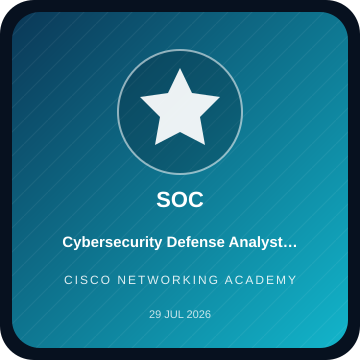
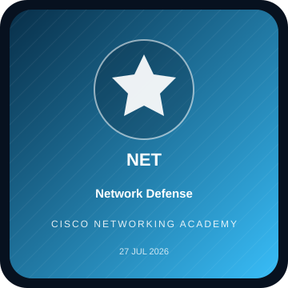
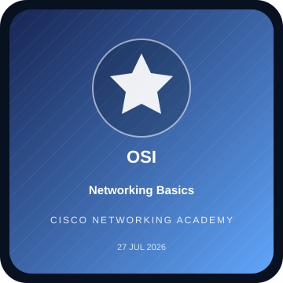
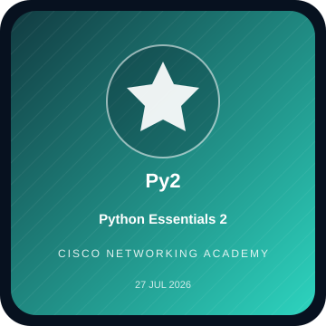
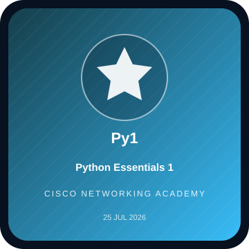
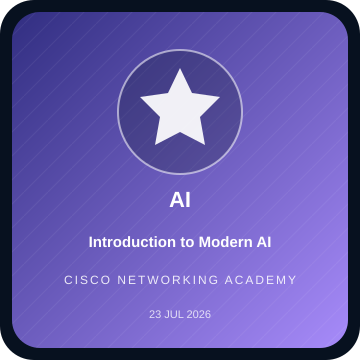
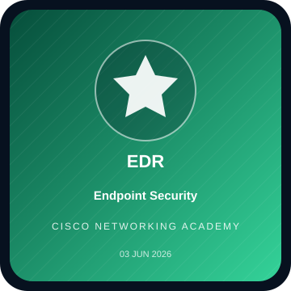
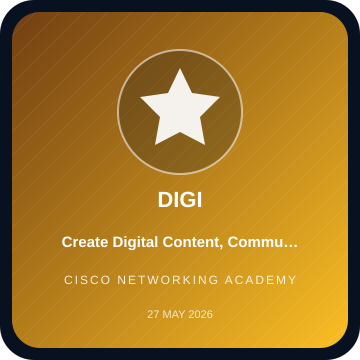
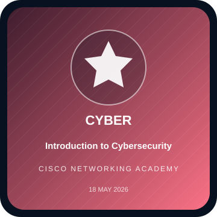

# Arfat Alkamali
### Cybersecurity & Networks · Software Development · Security Research

---

## Professional Profile

I am an undergraduate **Cybersecurity & Networks** student at **Al-Manar University College for Science & Technology**, building a practical engineering path across defensive security, network protection, secure software, and technical research.

My work combines academic study with independent software and cybersecurity projects. I am especially interested in designing reliable systems, understanding vulnerabilities at code and infrastructure level, and turning security concepts into testable tools and documented workflows.

**Professional direction:** Cybersecurity Engineering · Security Operations & Threat Detection · Secure Software Engineering · Applied Research

> **Building Systems. Securing the Future.**

## Focus Areas

| Domain | Current focus |
|---|---|
| **Cybersecurity Engineering** | Defensive architecture, vulnerability analysis, security controls, and risk-aware engineering |
| **Network Security** | Network fundamentals, traffic analysis, segmentation, monitoring, and Cisco technologies |
| **Security Operations** | Threat detection concepts, SOC workflows, incident handling, and evidence-aware investigation |
| **Secure Software** | Application development, source-code review, secure design, and database security |
| **Applied Research** | Cybersecurity methods, threat analysis, software supply-chain risk, and AI-assisted defense |

## Selected Engineering Work

### AEGIS-TITAN — Defensive Cybersecurity Platform
An independently developed defensive security project focused on connecting monitoring, threat analysis, detection, containment, deception, and incident-response workflows. The project is designed around defensive operations and evidence-aware handling rather than offensive retaliation.

**Focus:** Security telemetry · Threat detection · Network monitoring · Incident response · Digital forensics · Deception technology · Source-code security analysis

### Academic OS — Offline Academic Assistant
A local-first academic productivity application concept combining schedules, tasks, study planning, academic files, grade tracking, and privacy-conscious data handling.

**Focus:** Flutter/Dart · Local storage · Application architecture · User privacy · Productivity workflows

### Additional Software & Security Projects
The repository also documents academic software, web development, network-security exercises, virtual labs, and planned research prototypes.

- [Project portfolio and technical notes](PROJECTS.md)
- [Cybersecurity labs and practical exercises](LABS.md)
- [Research interests and publications-in-progress](#research-interests)

## Technical Skills

The list below describes areas I work with or study. It is not a claim of expert-level mastery in every technology.

### Programming & Software Development

### Cybersecurity & Infrastructure

### Development Tools & Data

## Credentials & Digital Badges

A visual index of learning achievements, with verification routed to the public issuer/Credly record. The square graphics are custom profile tiles; they are not presented as original issuer artwork.

| | | |
|:---:|:---:|:---:|
|  <b>Cybersecurity Defense Analyst Career Path</b> Cisco · 29 Jul 2026 |  <b>Network Defense</b> Cisco · 27 Jul 2026 |  <b>Networking Basics</b> Cisco · 27 Jul 2026 |
|  <b>Python Essentials 2</b> Cisco · 27 Jul 2026 |  <b>Python Essentials 1</b> Cisco · 25 Jul 2026 |  <b>Introduction to Modern AI</b> Cisco · 23 Jul 2026 |
|  <b>Endpoint Security</b> Cisco · 03 Jun 2026 |  <b>Digital Content & Collaboration</b> Cisco · 27 May 2026 |  <b>Introduction to Cybersecurity</b> Cisco · 18 May 2026 |

**Additional records:** [Cisco IT Customer Support Basics](https://www.credly.com/badges/dd68b74c-65f9-468f-9a51-3bb78adad239/public_url) · [Cisco Learn-A-Thon 2026 — Participant](https://www.credly.com/badges/a370a36f-7ce1-4531-b44b-b909e56ee52d/public_url) · [Introduction to Artificial Intelligence](https://lnkd.in/dRCcTwf5)

**[Open the complete Credentials Gallery](CREDENTIALS.md)** · **[Verify on Credly](https://www.credly.com/users/arfat-alkamly)**

## Education

**B.Sc. in Cybersecurity & Networks**  
Al-Manar University College for Science & Technology · Yemen  
2024–2028 (expected program period) · Currently Level 3

Relevant academic areas include information security, networks, cryptography, programming, databases, software development, and AI for cybersecurity.

## Leadership & Academic Contribution

**Scientific Committee Lead — Cybersecurity & Information Technology, Level 3**  
Al-Manar University College

- Coordinate academic communication and lecture-material distribution between the two departments.
- Organize course resources, references, assignment notices, and academic follow-up.
- Support a structured student information channel and representative workflow.

## Research Interests

- Defensive security engineering and multi-layer threat detection.
- Vulnerability analysis in open-source software and dependency ecosystems.
- Digital forensics, evidence integrity, and incident-response workflows.
- AI-assisted threat detection and behavioral analysis.
- Cloud, API, and software supply-chain security.
- Secure software development and privacy-aware telemetry.

Research concepts and proposals are documented separately; they are not represented as published papers or completed experimental findings.

## Learning Roadmap

My current development path prioritizes stronger foundations and practical evidence over collecting tools or listing every technology.

- **Core:** networking, Linux, Python, security fundamentals, and software engineering.
- **Applied security:** web and API security, vulnerability analysis, traffic inspection, and defensive monitoring.
- **Next specialization:** DFIR, threat hunting, cloud security, and secure development practices.

See the [detailed learning roadmap](ROADMAP.md) for study topics and planned milestones.

## Repository Map

| Resource | What you will find |
|---|---|
| [PROJECTS.md](PROJECTS.md) | Project descriptions, architecture notes, and development status |
| [LABS.md](LABS.md) | Practical lab environments, scenarios, and write-up structure |
| [CREDENTIALS.md](CREDENTIALS.md) | Visual credential gallery and public verification links |
| [ROADMAP.md](ROADMAP.md) | Learning plan and future specialization targets |
| [Portfolio Website](https://arfat-phi.vercel.app/) | Extended professional portfolio |

## Connect

- **GitHub:** [github.com/arfat-alkamly](https://github.com/arfat-alkamly)
- **LinkedIn:** [Professional profile](https://www.linkedin.com/in/arfat-alkamly-399676409)
- **Credly:** [Public digital credentials](https://www.credly.com/users/arfat-alkamly)
- **ORCID:** [0009-0008-1348-5146](https://orcid.org/0009-0008-1348-5146)
- **Portfolio:** [arfat-phi.vercel.app](https://arfat-phi.vercel.app/)

---

**BUILDING SYSTEMS. SECURING THE FUTURE.**

Independent learning · Practical engineering · Responsible security research

